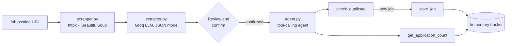

<div align="center">

# 💼 AI Job Tracker

**Paste a job link. Let an LLM read it. Track it with a tool-calling agent.**

<p>
  
  
  
  
  
</p>

</div>

AI Job Tracker turns a public job posting into a clean, trackable record. It scrapes the page, uses an LLM on [Groq](https://groq.com/) to extract the company, role, salary and requirements, lets you review the result, and then hands it to an **AI agent that decides which tools to call**: it checks for duplicates, saves the job, and answers questions about your tracker.

It ships with a **Streamlit web app** and a **command-line interface**.

---

## 📸 Screenshots

<table>
  <tr>
    <td width="50%" align="center">
      <b>➕ Add a Job</b><br/><br/>
      
    </td>
    <td width="50%" align="center">
      <b>📋 My Jobs</b><br/><br/>
      
    </td>
  </tr>
  <tr>
    <td colspan="2" align="center">
      <b>💬 Ask the Agent</b><br/><br/>
      
    </td>
  </tr>
</table>

---

## ✨ Features

- **Scrape any public job page**: fetches the page with `httpx`, strips navigation, footers, scripts and forms, and prefers the main article content (capped at 50,000 characters for the LLM).
- **Structured extraction**: the LLM returns JSON with `company`, `role`, `salary` and `requirements`. Missing values come back as `null` or an empty list instead of invented data.
- **Human in the loop**: extracted details are shown for review before anything is tracked, because LLM extraction can be wrong.
- **Tool-calling agent**: the agent chooses between `check_duplicate`, `save_job` and `get_application_count`, and runs for at most 5 tool rounds.
- **Duplicate protection, twice**: the agent is told to check first, and `save_job` also rejects case-insensitive duplicates on its own.
- **Job dashboard**: total, saved and applied counts plus a table of every tracked job.
- **Ask in plain English**: for example *"How many jobs are in my tracker?"* or *"How many jobs have I applied to?"*
- **Two interfaces**: a Streamlit app and a terminal menu.

---

## 🧠 How it works



### Design choices

| Concern | How it is handled |
| --- | --- |
| Hallucinated details | `temperature=0`, JSON response mode, and a prompt that says *"Do not invent information"* |
| False success messages | The agent prompt forbids claiming success without a tool result |
| Duplicate jobs | Checked by the agent **and** enforced inside `save_job` |
| Runaway tool loops | The agent loop is capped at 5 rounds |
| Noisy web pages | Boilerplate tags are removed before the text is sent to the LLM |

---

## 🧰 Tech stack

| Layer | Tools |
| --- | --- |
| Language | Python |
| UI | Streamlit |
| LLM | Groq API (chat completions with function calling) |
| Scraping | httpx, BeautifulSoup4 |
| Config | python-dotenv |
| Testing | pytest |

---

## 📁 Project structure

```
ai_job_tracker_agent/
├── backend/
│   ├── app.py            # Streamlit web app (Add a Job, My Jobs, Ask the Agent)
│   ├── main.py           # Command-line interface
│   ├── scrapper.py       # Fetches a job page and cleans it into readable text
│   ├── extractor.py      # LLM extraction of company, role, salary, requirements
│   ├── agent.py          # Tool definitions, system prompt and the agent loop
│   ├── job_tools.py      # check_duplicate, save_job, get_application_count + store
│   ├── requirements.txt
│   └── test/
│       ├── test_job_tools.py
│       ├── test_extractor.py
│       └── test_scrapper.py
└── README.md
```

---

## 🚀 Getting started

### 1. Clone and install

```bash
git clone https://github.com/sonam-yadav04/ai_job_tracker_agent.git
cd ai_job_tracker_agent/backend

python -m venv venv
# Windows:        venv\Scripts\activate
# macOS / Linux:  source venv/bin/activate

pip install -r requirements.txt
```

### 2. Add your Groq API key

Create a file named `.env` inside `backend/`:

```env
GROQ_API_KEY=your_groq_api_key_here
```

You can get a free key from the [Groq console](https://console.groq.com/keys). Never commit your `.env` file.

### 3. Run it

**Web app**

```bash
streamlit run app.py
```

Then open <http://localhost:8501>.

**Command line**

```bash
python main.py
```

---

## 🖥️ Usage

1. **Add a Job**: paste a public job posting URL and click **Scrape & Extract**.
2. **Review**: check the extracted company, role, salary and requirements. You can expand the scraped text to see what the LLM read.
3. **Confirm & Track Job**: the agent checks for duplicates, then saves the job with the status `saved`.
4. **My Jobs**: see your totals and the full table.
5. **Ask the Agent**: ask questions such as:
   - *How many jobs are in my tracker?*
   - *How many jobs have I applied to?*

---

## 🧪 Tests

```bash
cd backend
pytest test/test_job_tools.py
```

`test_job_tools.py` runs fully offline and covers saving, case-insensitive duplicate detection and status counts.

`test_extractor.py` and `test_scrapper.py` are integration tests: they need `GROQ_API_KEY` and an internet connection, because they call the live Groq API and a real job page.

---

## ⚠️ Current limitations

- **Phase 1 storage is in memory.** Tracked jobs are lost when the app restarts.
- **Static pages only.** Pages that render their content with JavaScript may return little or no text.
- **Extraction is best effort.** Always review the extracted details before confirming.
- **Status is set when a job is saved.** There is no tool yet to update a job's status afterwards.

## 🗺️ Planned improvements

- [ ] Persistent storage (SQLite or PostgreSQL)
- [ ] A tool to update a job's status (saved → applied → interview → offer)
- [ ] JavaScript-rendered pages through a headless browser
- [ ] Export tracked jobs to CSV
- [ ] Mocked unit tests for the LLM calls

---

## 👩‍💻 Author

**Sonam Yadav**, Full-Stack Developer

[](https://github.com/sonam-yadav04)
[](https://www.linkedin.com/in/sonam-yadav-242149325/)
[](https://portfolio-website-beta-one-57.vercel.app/)
